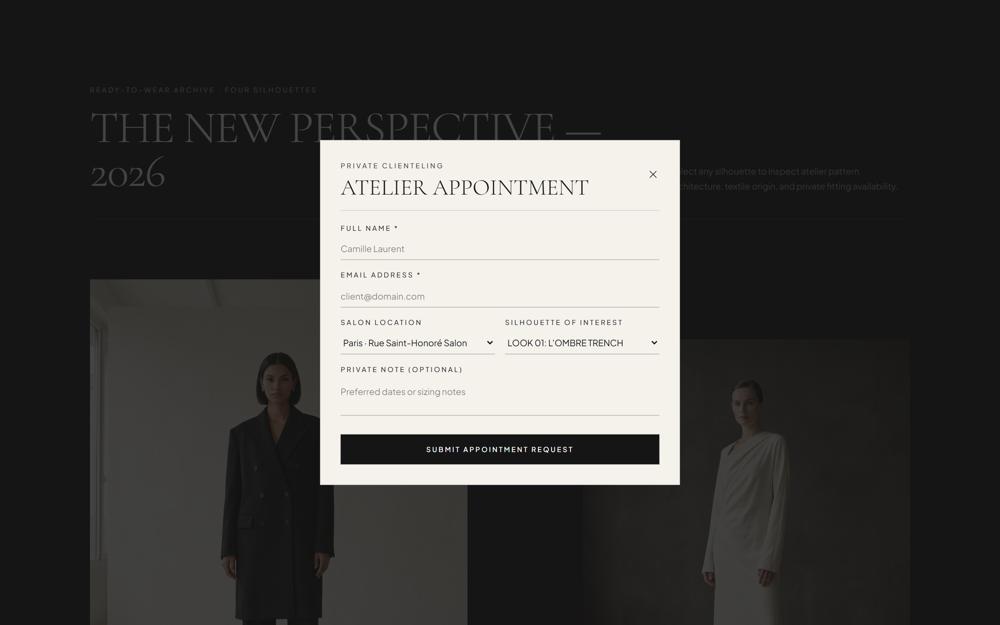
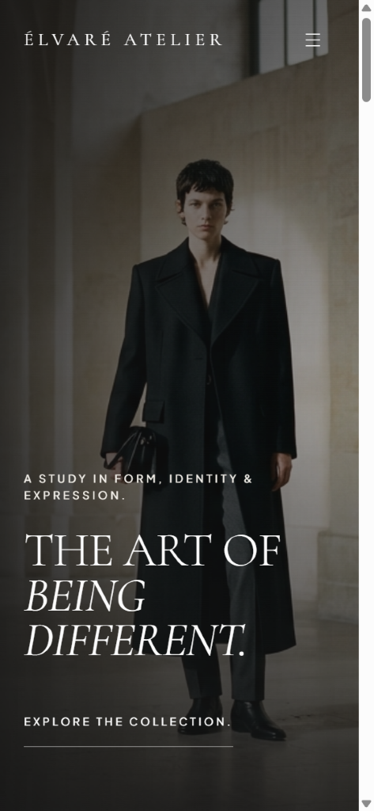
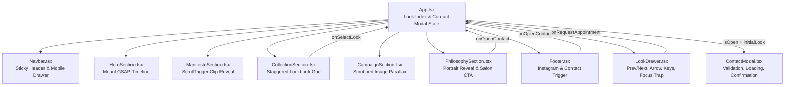
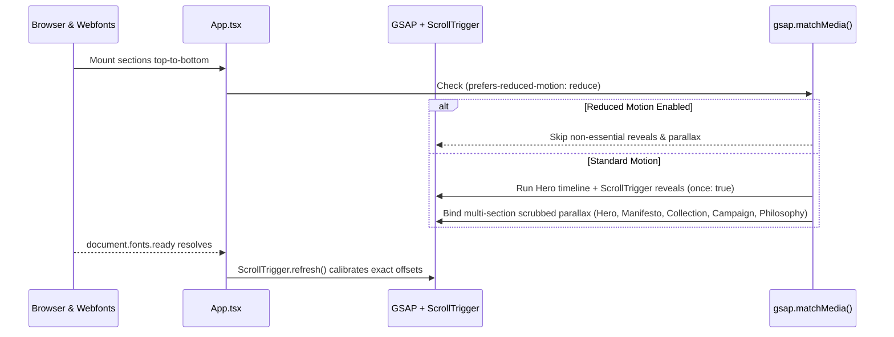

<div align="center">

# ÉLVARÉ ATELIER — Contemporary Luxury Fashion

**An editorial, one-page digital flagship for a fictional Paris and Milan luxury fashion house — crafted with asymmetrical typography, warm-ivory and obsidian pacing, GSAP ScrollTrigger choreography, and an interactive lookbook dossier.**

[](https://github.com/viochris/elvare-atelier)
[](https://react.dev/)
[](https://www.typescriptlang.org/)
[](https://tailwindcss.com/)
[](https://gsap.com/)
[](https://vite.dev/)
[](./LICENSE)

<br />


<br />

<sub>Opening editorial viewport (`2400×1500` Retina HD): full-bleed `100svh` limestone gallery framing, directional contrast scrims, and staggered `Cormorant Garamond` display typography.</sub>

<br /><br />

**[Overview](#overview)** · **[Problem and Solution](#problem-and-solution)** · **[Creative Direction & Design System](#creative-direction--design-system)** · **[Features & Sections](#features--sections)** · **[Screenshots](#screenshots)** · **[Architecture & Motion](#architecture--motion)** · **[Getting Started](#getting-started)** · **[Design Challenges](#design-challenges-and-solutions)** · **[Roadmap](#roadmap)**

</div>

---

## Important Notice

* **Editorial Brand Showcase:** ÉLVARÉ ATELIER is a fictional luxury fashion house built as a client-side single-page React application. It is designed as a brand monograph and lookbook showcase rather than a live transactional storefront.
* **Client-Side Appointment Inquiry:** Submitting the **Atelier Appointment** modal performs full client-side validation and transitions through a simulated loading and confirmation state (`REQUEST REGISTERED`). It does not transmit emails or store client data on a remote server.
* **Self-Contained Assets & Zero Secrets:** All 8 editorial photographs are served locally from [`public/images/`](./public/images). This repository contains **no API keys, tokens, or `.env` credentials**.

---

## Table of Contents

1. [Overview](#overview)
2. [Problem and Solution](#problem-and-solution)
3. [Creative Direction & Design System](#creative-direction--design-system)
4. [Features & Sections](#features--sections)
5. [Screenshots](#screenshots)
6. [Architecture & Motion](#architecture--motion)
7. [Tech Stack](#tech-stack)
8. [Project Structure](#project-structure)
9. [Getting Started](#getting-started)
10. [Customization Guide](#customization-guide)
11. [Production Build and Deployment](#production-build-and-deployment)
12. [Security, Accessibility, and Quality Verification](#security-accessibility-and-quality-verification)
13. [Design Challenges and Solutions](#design-challenges-and-solutions)
14. [Known Limitations](#known-limitations)
15. [Roadmap](#roadmap)
16. [Troubleshooting](#troubleshooting)
17. [Contributing](#contributing)
18. [License](#license)

---

## Overview

**ÉLVARÉ ATELIER** is a contemporary luxury fashion web application built to feel like an independent European fashion house rather than a generic landing page template. Every scroll band alternates intentional warmth (`#F5F2EC` Warm Ivory) and architectural weight (`#151515` Deep Obsidian), pairing oversized serif editorial headlines with restrained uppercase grotesque metadata and smooth GSAP ScrollTrigger choreography.

### Project Summary

| Aspect | Specification |
|---|---|
| **Application Type** | Client-side editorial single-page application (Vite + React 19 + TypeScript) |
| **Core Experience** | Full-screen hero, brand manifesto, asymmetrical 4-look archive, interactive look dossier drawer, parallax campaign spread, house philosophy, and private salon appointment modal |
| **Animation Engine** | GSAP `3.13.0` (`gsap`, `@gsap/react`, `ScrollTrigger`) with `gsap.matchMedia()` for `prefers-reduced-motion` |
| **Typography** | `Cormorant Garamond` (editorial display serif) + `Plus Jakarta Sans` (tracked grotesque sans-serif metadata) |
| **Styling System** | Tailwind CSS v4 via `@tailwindcss/vite`, sharp `0px` architectural corners, zero template card clutter |
| **Catalog & Imagery** | Strongly typed lookbook catalog in [`src/data/looks.ts`](./src/data/looks.ts) + 8 cohesive studio photographs in [`public/images/`](./public/images) |
| **Version History** | `main` holds the finalized **VERSI 1** flagship (tagged `versi-1`); an experimental left-rail prototype is archived locally on `versi-2-proto` |

The engineering decisions behind the responsive framing, GSAP calibration, keyboard focus trapping, and modal containment are documented in [Design Challenges and Solutions](#design-challenges-and-solutions).

---

## Problem and Solution

Luxury digital flagships fail when they borrow generic SaaS patterns—rounded cards, uniform 3-column feature grids, saturated gradients, or uncalibrated animations that jank on mobile. **ÉLVARÉ ATELIER** solves these common pitfalls explicitly:

| Problem | How ÉLVARÉ ATELIER Addresses It |
|---|---|
| **Generic SaaS / AI Template Look** | Replaces uniform card grids, pill badges, and decorative glows with asymmetrical 12-column editorial spreads, `0px` sharp geometry, and hairline dividers inspired by **The Row**, **Lemaire**, **Khaite**, and **Celine**. |
| **Illegible Copy Over Photography** | Adds controlled multi-directional `#151515` gradient scrims (top, bottom, and left) so navigation links and white serif headlines stay crisp even over bright architectural windows or ivory garments. |
| **Landscape Hero Cropping on Mobile** | Uses focal-point overrides (`object-[72%_center]` in Hero, `object-[68%_center]` in Campaign) below `md` so models remain cleanly framed on `320px`–`390px` portrait screens instead of being sliced off at the edges. |
| **Static Lookbook Thumbnails** | Clicking any look opens an accessible slide-over **Look Dossier Drawer** detailing silhouette architecture, textile composition (GSM / momme), atelier craft notes, keyboard/button cycling, and a direct appointment handoff. |
| **Scroll Animation Layout Drift** | Calls `ScrollTrigger.refresh()` once `document.fonts.ready` resolves and animates only GPU-friendly `transform`, `autoAlpha`, and `clipPath` properties wrapped inside `gsap.matchMedia()`. |
| **Broken Modal Focus & Short-Screen Clipping** | Implements a shared [`trapFocusInContainer`](./src/utils/focusTrap.ts) helper across the mobile drawer, LookDrawer, and ContactModal, enforces `max-h-[92svh] overflow-y-auto`, and resets all fields/selects cleanly on close. |

### Design Goals

* **Editorial Restraint First:** Let large-format studio photography and generous negative space carry the luxury identity without decorative clutter.
* **Accessible by Construction:** Enforce WCAG AA/AAA text contrast, `44px+` minimum touch targets, semantic HTML landmarks, `:focus-visible` outlines, and `prefers-reduced-motion` fallbacks.
* **Zero Layout Shift:** Declare explicit intrinsic `width`/`height` dimensions and aspect-ratio wrappers on every image, with `fetchPriority="high"` on the hero frame.
* **Honest Client States:** Even as a static showcase, forms expose explicit validation errors, submitting indicators, and full reset behavior rather than dead controls.

---

## Creative Direction & Design System

The aesthetic pairs warm Parisian limestone ivory with severe obsidian wool tailoring, balancing editorial delicacy against architectural structure.

### Reference Benchmarking DNA

* **The Row (`therow.com`):** Ultra-minimalist top bar pacing, generous negative space, and quiet monoline restraint.
* **Lemaire (`lemaire.fr`):** Warm ivory and muted earth tonal rhythm paired with crisp tabular metadata.
* **Khaite (`khaite.com`):** Oversized high-contrast editorial serif headlines contrasted with tracked uppercase sans labels.
* **Celine (`celine.com`):** Stark monochrome discipline, alternating light/dark backdrop cadence, and sharp rectangular geometry.

### Color Palette

| Token | Hex | Surface / Role | Contrast Pairing |
|---|---|---|---|
| **Warm Ivory** | `#F5F2EC` | Light editorial canvas, scrolled navbar, drawer & modal panels | Paired with `#151515`, `#383838`, and `#524E48` |
| **Deep Obsidian** | `#151515` | Dark editorial sections, primary CTAs, mobile navigation drawer | Paired with `#FFFFFF`, `#F5F2EC`, and `#A6A39E` |
| **Soft Charcoal** | `#383838` | Editorial body paragraphs on Warm Ivory & button hover surface | High legibility without harsh pure-black body blocks |
| **Muted Stone** | `#A6A39E` | Secondary uppercase metadata on `#151515` dark sections | Over `7:1` WCAG AAA contrast on `#151515` |
| **Dark Stone** | `#524E48` | Secondary uppercase metadata on `#F5F2EC` ivory sections | Over `7:1` WCAG AAA contrast on `#F5F2EC` |
| **Pure White** | `#FFFFFF` | Hero & campaign display headlines and dark-section primary titles | Layered over calibrated `#151515` gradient scrims |

### Typography & Scale

| Role | Family | Weight & Style | Tracking & Leading | Usage |
|---|---|---|---|---|
| **Display Hero (`h1`)** | `Cormorant Garamond` | `300` Light / `400` Italic | `clamp(3rem, 7.2vw, 6.25rem)`, `leading-[0.94]`, `-0.02em` | `"THE ART OF BEING DIFFERENT."` |
| **Editorial Section (`h2`)** | `Cormorant Garamond` | `300` Light / `400` Italic | `clamp(2.35rem, 6.5vw, 5.75rem)`, `leading-[0.94]`–`[1.02]` | Manifesto, Collection, Campaign, Philosophy |
| **Look Titles (`h3`) & Quotes** | `Cormorant Garamond` | `400` Regular | `1.5rem`–`1.85rem`, `leading-[1.35]` | Look names and Manifesto blockquote |
| **Navigation & Metadata** | `Plus Jakarta Sans` | `500` Medium Uppercase | `11px`, tracking `0.18em`–`0.26em` | Nav links, section tags, plate captions, CTAs |
| **Editorial Body Copy** | `Plus Jakarta Sans` | `400` Regular | `14px` (`text-sm`), `leading-[1.7]`–`[1.85]` | Atelier commentary, fabric specs, form inputs |

---

## Features & Sections

### 1. Editorial Navigation & Mobile Drawer ([`Navbar.tsx`](./src/components/Navbar.tsx))
* Fixed `80px` top bar starting transparent (`#FFFFFF` ink) over the Hero and transitioning smoothly to Warm Ivory (`#F5F2EC/95` with `backdrop-blur-sm` and hairline bottom border) past `48px` scroll.
* Smooth-scroll links (`COLLECTION`, `CAMPAIGN`, `ABOUT`) plus brand home link (`ÉLVARÉ ATELIER` -> `#hero`).
* Full-screen `#151515` mobile drawer (`< md`) with `44×44px` trigger, `overflow-y-auto` support for short landscape phones, `Escape` dismissal, keyboard focus trapping, and focus restoration back to the menu button.

### 2. Full-Screen Hero ([`HeroSection.tsx`](./src/components/HeroSection.tsx))
* `100svh` limestone gallery photograph (`fetchPriority="high"`, eager load) protected by top, bottom, and left directional contrast scrims so navigation links stay crisp over the upper-right sunlit window.
* Staggered GSAP entrance sequence revealing `A STUDY IN FORM, IDENTITY & EXPRESSION.`, `"THE ART OF BEING DIFFERENT."`, and `"EXPLORE THE COLLECTION."` CTA, paired with scrubbed scroll parallax (`yPercent: 0` -> `10` inside a `120%` vertical bleed wrapper) and subtle headline depth drift.

### 3. Brand Manifesto ([`ManifestoSection.tsx`](./src/components/ManifestoSection.tsx))
* Asymmetrical 12-column editorial spread (`#about`) pairing `ATELIER NOTES · PARIS / MILAN · SEASON 2026`, `"BEYOND THE ORDINARY."`, and the brand manifesto quote with a `3:4` sculptural cashmere/silk cape study (`PLATE 01 · SILHOUETTE STUDY`).
* GSAP `ScrollTrigger` timeline combining vertical `clipPath` curtain reveal (`inset(100% 0% 0% 0%)` -> `0%`), image scale settle, and scrubbed internal portrait parallax (`yPercent: -6` -> `+6`).

### 4. The Collection & Look Dossier Drawer ([`CollectionSection.tsx`](./src/components/CollectionSection.tsx), [`LookDrawer.tsx`](./src/components/LookDrawer.tsx))
* Staggered 12-column obsidian gallery (`#collection`, `"THE NEW PERSPECTIVE — 2026"`) showcasing **4 signature silhouettes** with alternating `3:4` and `4:5` proportions, internal image parallax (`yPercent: -5` -> `+5`), and desktop staggered column depth parallax (`±22px` vs. `±48px`):

| Look | Title | Category | Textile Composition | Atelier Craft Detail |
|---|---|---|---|---|
| `LOOK 01` | **L'OMBRE TRENCH** | Architectural Outerwear | 100% Double-Faced Italian Virgin Wool Gabardine (540gsm), Cupro Twill Lining | Hand-felled collar stand, concealed horn buttons, raw-edge internal taping |
| `LOOK 02` | **IVOIRE DRAPED COLUMN** | Evening & Fluid Silk | 100% Heavyweight Mulberry Silk Crêpe de Chine (32 momme), Warm Ivory Dye | Single-seam French finishing, weighted silk hem for controlled drape |
| `LOOK 03` | **STRUCTURE TAILLEUR** | Atelier Tailoring | 85% Super 150s Merino Wool, 15% Mongolian Cashmere Melange, Silk Camisole Base | Floating horsehair chest canvas, hand-worked Milanese lapel buttonhole |
| `LOOK 04` | **NOCTURNE LEATHER COAT** | Signature Outerwear | Full-Grain Matte Plongé Lambskin, Fine-Gauge 18gg Ivory Merino Knit | Skived flatlock seams, tonal saddle-stitched belt loops, silk sleeve lining |

* Clicking any look opens the **Look Dossier Drawer** with independent desktop dossier scrolling, `PREVIOUS` / `NEXT` cycling (buttons or `ArrowLeft` / `ArrowRight` keys), `Escape` close, and a direct **`REQUEST PRIVATE FITTING`** CTA that pre-fills the silhouette inside `ContactModal`.

### 5. Campaign Editorial ([`CampaignSection.tsx`](./src/components/CampaignSection.tsx))
* Dramatic `88svh` twilight colonnade spread (`#campaign`) showcasing `"FORM MEETS FREEDOM."` with deep GSAP `ScrollTrigger` scrubbed parallax (`yPercent: -10` to `+10` inside a static `-top-[12%]` `h-[124%]` bleed container).

### 6. House Philosophy, Footer & Private Salon Modal ([`PhilosophySection.tsx`](./src/components/PhilosophySection.tsx), [`Footer.tsx`](./src/components/Footer.tsx), [`ContactModal.tsx`](./src/components/ContactModal.tsx))
* Architectural ivory spread (`#philosophy`) presenting `"WE DO NOT FOLLOW THE MOMENT. WE DEFINE IT."` alongside a three-quarter back-seam cashmere portrait with internal scrubbed parallax (`yPercent: -6` -> `+6`), opposing desktop statement drift (`±24px`), and `BOOK PRIVATE SALON` trigger.
* Minimalist dark footer with **ÉLVARÉ ATELIER**, `"WEAR YOUR IDENTITY."`, external `INSTAGRAM` link (`rel="noopener noreferrer"`), `CONTACT` modal trigger, and `© 2026 ÉLVARÉ ATELIER`.
* Accessible **Atelier Appointment** modal featuring client-side validation (`FULL NAME *`, `EMAIL ADDRESS *`), salon location dropdown (`Paris · Rue Saint-Honoré Salon`, `Milan · Via Brera Atelier`, `Private Virtual Consultation`), silhouette selector, loading state (`REGISTERING REQUEST...`), confirmation view (`REQUEST REGISTERED`), and full field/select reset on close.

---

## Screenshots

> All screenshots below were captured directly from the live application in **Retina HD** (`2400×1500` desktop & `975×2110` mobile) with `Cormorant Garamond` and `Plus Jakarta Sans` loaded. All files reside in [`img/`](./img).

### Collection Lookbook & Interactive Look Dossier

| Asymmetrical Collection Grid (`2400×1500`) | Look Dossier Drawer (`2400×1500`) |
|:---:|:---:|
|  |  |
| Staggered 12-column obsidian gallery (`THE NEW PERSPECTIVE — 2026`) with varied `3:4` and `4:5` aspect framing. | Interactive dossier with silhouette architecture, textile composition, `REQUEST PRIVATE FITTING`, and `01 / 04` cycling. |

### Private Clienteling Modal & Mobile Viewport

| Atelier Appointment Modal (`2400×1500`) | Mobile Hero Framing (`975×2110`) |
|:---:|:---:|
|  |  |
| Sharp `0px` Warm Ivory modal with pre-selected silhouette, accessible validation, and `max-h-[92svh]` containment. | Mobile viewport (`390×844` @ 2.5× Retina) using `object-[72%_center]` focal framing and a `44×44px` menu trigger. |

---

## Architecture & Motion

### Component & Interactive State Flow



### GSAP Motion Lifecycle



* **Scoped React Lifecycle:** Every component uses `useGSAP(..., { scope: sectionRef })` so all animations and `ScrollTrigger` instances revert cleanly on unmount or hot reload.
* **GPU-Composited Properties Only:** Animations strictly target `transform` (`x`, `y`, `scale`, `yPercent`), `autoAlpha`, and `clipPath`, avoiding expensive layout reflows.

---

## Tech Stack

| Category | Technology | Version | Purpose |
|---|---|---|---|
| **UI Framework** | [React](https://react.dev/) | `19.1.1` | Component architecture, accessible modal/drawer state |
| **Language** | [TypeScript](https://www.typescriptlang.org/) | `~5.9.2` | Strict typing (`strict`, `noUncheckedIndexedAccess`, `noUnusedLocals`) |
| **Styling** | [Tailwind CSS](https://tailwindcss.com/) | `4.1.14` | Design tokens via `@theme` + utility-first responsive layout |
| **Animation** | [GSAP](https://gsap.com/) + `@gsap/react` | `3.13.0` / `2.1.2` | Editorial reveal timelines, `ScrollTrigger` parallax, `matchMedia()` |
| **Icons** | [Lucide React](https://lucide.dev/) | `0.546.0` | Minimalist stroke icons (`Menu`, `X`, `ChevronLeft`, `ChevronRight`) |
| **Build Tool** | [Vite](https://vite.dev/) | `7.1.7` | Fast HMR dev server and optimized ES module bundling |
| **Webfonts** | Google Fonts | — | `Cormorant Garamond` (300/400/500/600) & `Plus Jakarta Sans` (300–600) |

---

## Project Structure

```text
elvare-atelier/
├── img/                                  # Retina HD README screenshots (5 PNGs)
│   ├── 01-hero-desktop.png               # 2400×1500 desktop hero
│   ├── 02-collection-lookbook.png        # 2400×1500 staggered collection grid
│   ├── 03-look-drawer.png                # 2400×1500 LookDrawer dossier
│   ├── 04-contact-modal.png              # 2400×1500 Atelier Appointment modal
│   └── 05-mobile-hero.png                # 975×2110 mobile hero
├── public/
│   └── images/                           # Cohesive studio photography (8 JPEGs)
│       ├── hero-editorial.jpg
│       ├── manifesto-atelier.jpg
│       ├── look-01.jpg
│       ├── look-02.jpg
│       ├── look-03.jpg
│       ├── look-04.jpg
│       ├── campaign-spread.jpg
│       └── philosophy-portrait.jpg
├── src/
│   ├── components/
│   │   ├── Navbar.tsx                    # Fixed editorial top bar & mobile drawer
│   │   ├── HeroSection.tsx               # 100svh hero with directional scrims
│   │   ├── ManifestoSection.tsx          # Brand manifesto & Atelier Notes
│   │   ├── CollectionSection.tsx         # Staggered 4-look asymmetrical showcase
│   │   ├── CampaignSection.tsx           # Scrubbed parallax campaign spread
│   │   ├── PhilosophySection.tsx         # Closing statement & salon invitation
│   │   ├── Footer.tsx                    # Minimalist luxury colophon
│   │   ├── LookDrawer.tsx                # Slide-over dossier with prev/next cycling
│   │   └── ContactModal.tsx              # Private appointment inquiry modal
│   ├── data/
│   │   └── looks.ts                      # Strongly typed LookItem catalog & salons
│   ├── utils/
│   │   └── focusTrap.ts                  # Shared keyboard Tab focus-trap helper
│   ├── App.tsx                           # Root composition, font refresh & dialog state
│   ├── index.css                         # Tailwind v4 @theme tokens & base rules
│   └── main.tsx                          # React 19 entry point
├── index.html                            # Document metadata & Google Fonts
├── package.json                          # Dependencies and build scripts
├── package-lock.json                     # Locked dependency tree
├── tsconfig.json                         # Strict TypeScript compiler configuration
├── vite.config.ts                        # Vite + React + Tailwind v4 plugin config
├── .gitignore                            # Ignores node_modules, dist, .env*, *.tsbuildinfo
├── LICENSE                               # MIT License
└── README.md                             # Project documentation
```

---

## Getting Started

### Prerequisites

* [Node.js](https://nodejs.org/) **18+ or 20+ LTS**
* `npm` (bundled with Node.js)

### Installation & Local Development

```bash
# 1. Clone the repository
git clone https://github.com/viochris/elvare-atelier.git
cd elvare-atelier

# 2. Install dependencies
npm install

# 3. Start the Vite development server
npm run dev
```

Open **http://localhost:5173/** in your browser.

### Available Scripts

| Command | Description |
|---|---|
| `npm run dev` | Starts the Vite dev server with Hot Module Replacement at `http://localhost:5173/`. |
| `npm run build` | Runs `tsc -b` strict TypeScript checking and bundles production assets into `dist/`. |
| `npm run preview` | Serves the compiled `dist/` production bundle locally at `http://localhost:4173/`. |
| `npx tsc --noEmit` *(or `./node_modules/.bin/tsc --noEmit`)* | Type-checks all `.ts` / `.tsx` sources without emitting files. |

---

## Customization Guide

* **Add or Edit Silhouettes:** Update `COLLECTION_LOOKS` or `ATELIER_SALONS` inside [`src/data/looks.ts`](./src/data/looks.ts). Each item enforces `readonly` metadata (`number`, `title`, `collection`, `editorialNote`, `silhouette`, `fabric`, `craftDetail`, `image`, `alt`, `width`, `height`, and `aspectClass`).
* **Adjust Color Tokens & Base Rules:** Edit the `@theme` block inside [`src/index.css`](./src/index.css) (`--color-ivory`, `--color-obsidian`, `--color-charcoal`, `--color-stone`, `--color-stone-dark`, `--color-white`).
* **Swap Typography:** Update the Google Fonts `<link>` in [`index.html`](./index.html) and `--font-serif` / `--font-sans` inside [`src/index.css`](./src/index.css).
* **Tune Scroll & Parallax Timing:** Each section defines its own isolated `useGSAP()` timeline and `ScrollTrigger` thresholds (`start`, `scrub`, `stagger`), making per-section motion tuning self-contained.

---

## Production Build and Deployment

```bash
# 1. Type-check and compile production assets into dist/
npm run build

# 2. Preview the production bundle locally
npm run preview
```

Because **ÉLVARÉ ATELIER** is a pure static Vite SPA with zero server dependencies, the `dist/` output deploys directly to:

* **Vercel / Netlify / Cloudflare Pages:** Connect the `viochris/elvare-atelier` repository, set build command to `npm run build`, and publish directory to `dist`.
* **GitHub Pages:** Set `base: '/elvare-atelier/'` in [`vite.config.ts`](./vite.config.ts) if deploying to a project subpath (`https://viochris.github.io/elvare-atelier/`).

---

## Security, Accessibility, and Quality Verification

| Area | Verification & Implementation |
|---|---|
| **Repository Hygiene** | Zero API keys, tokens, or `.env` files exist in the codebase. [`.gitignore`](./.gitignore) excludes `.env`, `.env.*`, `*.local`, `*.tsbuildinfo`, `node_modules/`, and `dist/`. |
| **Keyboard Navigation** | Shared [`trapFocusInContainer`](./src/utils/focusTrap.ts) traps `Tab` / `Shift+Tab` inside the mobile drawer, `LookDrawer`, and `ContactModal`, restores focus on close, and supports `Escape` + `ArrowLeft`/`ArrowRight` look cycling. |
| **Semantics & Affordances** | Native `<header>`, `<nav>`, `<main>`, `<section>`, `<footer>`, `<button>`, and `<a>` elements with `:focus-visible` rings, `44px+` tap targets, `aria-modal`, and `aria-labelledby`. |
| **Multi-Viewport QA** | Tested live across **`320×568`**, **`375×812`**, **`768×1024`**, **`1280×680`**, and **`1440×900`** with `0` console/page errors, `0` horizontal overflow, and HTTP `200` on all 8 images. |
| **External Link Safety** | External links apply `target="_blank" rel="noopener noreferrer"`. |

---

## Design Challenges and Solutions

| # | Challenge | Solution |
|---|---|---|
| 1 | **Landscape Hero & Campaign Framing on Narrow Phones** | `hero-editorial.jpg` and `campaign-spread.jpg` place models on the right third of a `16:9` frame. Applying `object-[72%_center]` and `object-[68%_center]` below `md` keeps the figures centered on `320px`–`390px` portrait screens. |
| 2 | **Top-Bar Legibility Over Bright Gallery Clerestory** | Added a subtle top-down dark gradient scrim in [`HeroSection.tsx`](./src/components/HeroSection.tsx) so `11px` white nav items stay legible against the upper-right sunlit window. |
| 3 | **GSAP Parallax Overwriting Static CSS Offset** | Using static bleed offsets (`-top-[14%] h-[120%]` in Hero, `-top-[12%] h-[124%]` in Campaign, and dedicated inner `[data-*-parallax]` wrappers in Manifesto, Collection, and Philosophy) instead of CSS `translateY` ensures GSAP `yPercent` parallax never strips centering or collides with hover `scale` tweens. |
| 4 | **Short-Laptop Modal Clipping & 320px Overflow** | Constrained [`ContactModal.tsx`](./src/components/ContactModal.tsx) with `max-h-[92svh] overflow-y-auto overflow-x-hidden`, tightened vertical padding, added `min-w-0 truncate` on selects, and set solid `#F5F2EC` option backgrounds. |
| 5 | **Stale Salon / Look Selections After Reopening Modal** | Unified `handleResetAndClose` in [`ContactModal.tsx`](./src/components/ContactModal.tsx) to reset `salon`, `selectedLook`, `status`, `errors`, and all text inputs on every close path (`Escape`, backdrop click, X button, or `RETURN TO ATELIER`). |
| 6 | **Mobile Campaign Text Over Ivory Garments (`320×568`)** | Strengthened the mobile gradient scrim (`from-[#151515]/90 via-[#151515]/68 to-[#151515]/40`) below `md` so `"FORM MEETS FREEDOM."` and body copy maintain strong contrast. |
| 7 | **Independent Dossier Scrolling on Desktop** | Configured [`LookDrawer.tsx`](./src/components/LookDrawer.tsx) with `md:overflow-hidden` on the outer grid and `md:overflow-y-auto` on the right dossier column so the portrait remains full-height while details scroll smoothly on shorter screens. |
| 8 | **Mobile Landscape Drawer Accessibility (`568×320`)** | Added `overflow-y-auto` to `#mobile-navigation-drawer` in [`Navbar.tsx`](./src/components/Navbar.tsx) so all navigation links remain reachable in short landscape orientation. |
| 9 | **ScrollTrigger Misalignment After Font Load** | Invoked `ScrollTrigger.refresh()` inside [`App.tsx`](./src/App.tsx) after `document.fonts.ready` resolves so trigger positions match final webfont metrics. |
| 10 | **Dialog Keyboard Leakage** | Extracted [`trapFocusInContainer`](./src/utils/focusTrap.ts) and wired it to all three dialogs (`Navbar` mobile drawer, `LookDrawer`, `ContactModal`) so `Tab` never escapes behind an active overlay. |

---

## Known Limitations

* **Client-Only Appointment Form:** `ContactModal` simulates submission with a `450ms` local state transition (`REQUEST REGISTERED`) and does not persist bookings to a backend or email service.
* **Static Lookbook Data:** Collection looks (`LOOK 01`–`LOOK 04`) live in [`src/data/looks.ts`](./src/data/looks.ts) rather than an external CMS.
* **Placeholder Social URL:** The footer `INSTAGRAM` link navigates to `https://www.instagram.com/` since ÉLVARÉ ATELIER is a fictional luxury house.
* **No Automated Test Runner Configured:** Quality is verified via strict TypeScript (`tsc -b`), Vite production builds, and multi-viewport live browser QA; unit/E2E test frameworks (Vitest/Playwright) are not yet configured in `package.json`.

---

## Roadmap

### Completed in v1.0.0 (**VERSI 1**)
- [x] Full-bleed editorial hero, manifesto, staggered 4-look archive, parallax campaign, philosophy, and minimalist footer
- [x] Interactive `LookDrawer` with keyboard navigation and direct fitting appointment handoff
- [x] `ContactModal` with field validation, loading/confirmation states, and full close reset
- [x] GSAP `ScrollTrigger` choreography with `prefers-reduced-motion` support and font-ready calibration
- [x] Multi-viewport verification across `320×568`, `375×812`, `768×1024`, `1280×680`, and `1440×900`

### Planned
- [ ] **Real Clienteling Backend:** Connect `ContactModal` to a serverless endpoint or transactional email API (e.g., Resend or Formspree).
- [ ] **Headless CMS Integration:** Manage seasonal collections, fabrics, and editorial plates dynamically from a headless CMS.
- [ ] **Automated Test Suite & CI:** Add Vitest component tests, Playwright visual/responsive regression checks, and a GitHub Actions workflow.
- [ ] **Multi-Language Switcher:** Add French (`FR`) and Italian (`IT`) editorial copy options for the Paris and Milan salons.

---

## Troubleshooting

| Problem | Likely Cause & Fix |
|---|---|
| `npm install` fails or Vite errors on startup | Verify **Node.js 18+ or 20+ LTS** is active, clear any partial `node_modules`, and run `npm install`. |
| `npx tsc --noEmit` fails offline on Windows | Invoke the local TypeScript binary directly: `.\node_modules\.bin\tsc --noEmit` (or `npm run build`). |
| Typography renders in fallback fonts | Confirm internet access to `fonts.googleapis.com` defined in [`index.html`](./index.html). |
| Images fail to load when opening `index.html` | Serve the app through `npm run dev` or `npm run preview` rather than opening `index.html` via `file://`. |
| Scroll reveals or parallax do not animate | Check OS **Reduce Motion** settings; GSAP intentionally disables non-essential motion when `prefers-reduced-motion: reduce` is enabled. |

---

## Contributing

Contributions and suggestions are welcome.

1. Fork the repository and create a branch: `git checkout -b feature/your-feature`.
2. Make your changes, then verify both `.\node_modules\.bin\tsc --noEmit` and `npm run build` pass cleanly.
3. Commit with a clear message and open a pull request describing what changed and how it was tested.

Bug reports and feature requests are welcome at the [issue tracker](https://github.com/viochris/elvare-atelier/issues).

---

## License

Released under the [MIT License](./LICENSE).

---

<div align="center">

**ÉLVARÉ ATELIER** — *WEAR YOUR IDENTITY.*

Built by [@viochris](https://github.com/viochris) · [GitHub Repository](https://github.com/viochris/elvare-atelier) · [Report an Issue](https://github.com/viochris/elvare-atelier/issues)

</div>
