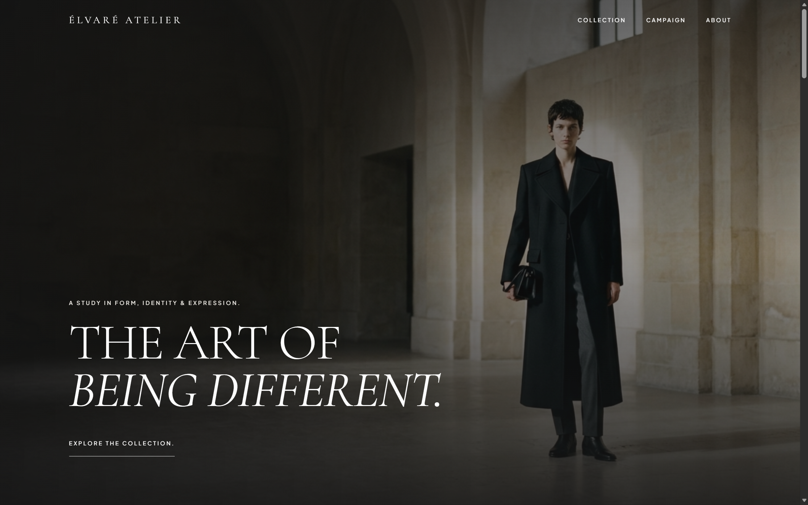
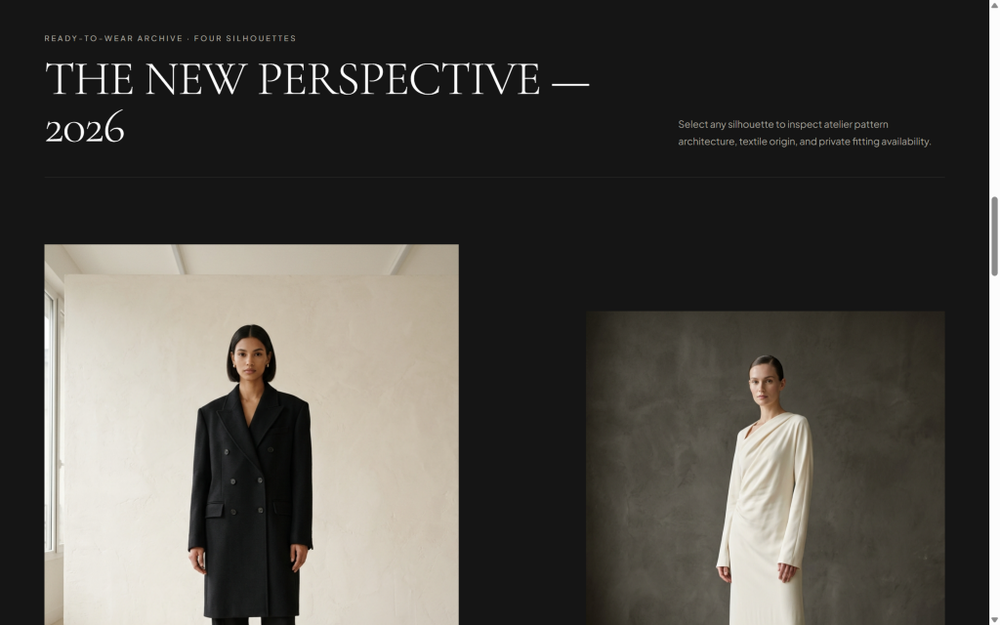
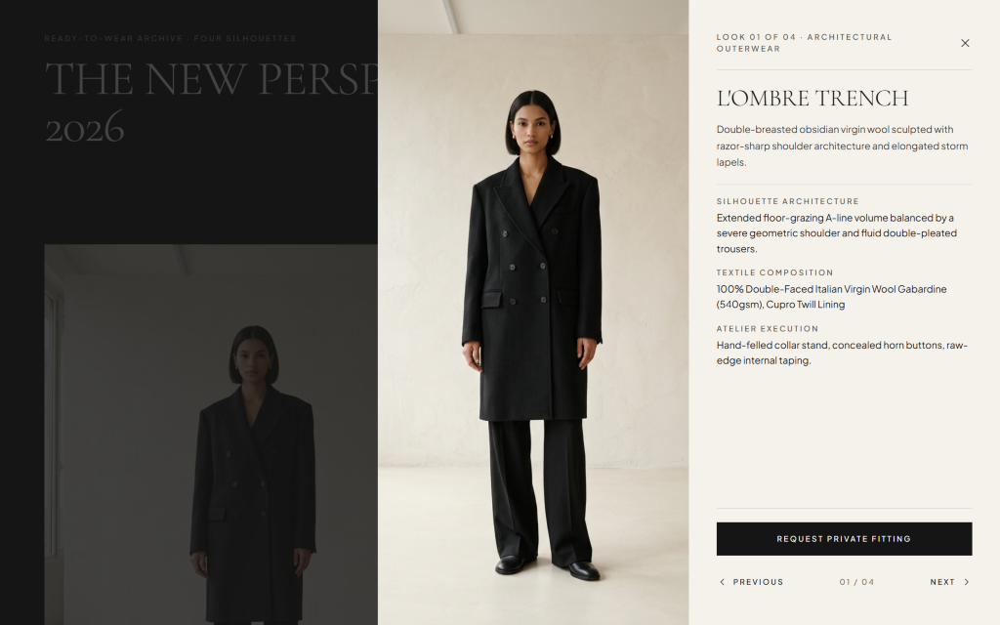
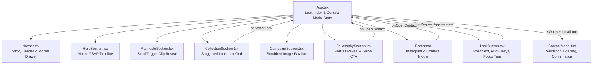

<div align="center">

# ÉLVARÉ ATELIER — Contemporary Luxury Fashion

**An editorial, one-page digital flagship for a fictional Paris and Milan luxury fashion house — crafted with asymmetrical typography, warm-ivory and obsidian pacing, GSAP ScrollTrigger choreography, and an interactive lookbook dossier.**

[](https://github.com/viochris/elvare-atelier)
[](https://react.dev/)
[](https://www.typescriptlang.org/)
[](https://tailwindcss.com/)
[](https://gsap.com/)
[](https://vite.dev/)
[](./LICENSE)

<br />



<sub>Opening editorial viewport (`2400×1500` Retina HD): full-bleed `100svh` limestone gallery framing, high-contrast directional scrim, and staggered `Cormorant Garamond` display typography.</sub>

<br />

**[Overview](#overview)** · **[Creative Direction & Design System](#creative-direction--design-system)** · **[Features & Sections](#features--sections)** · **[Screenshots](#screenshots)** · **[Architecture & Motion](#architecture--motion)** · **[Getting Started](#getting-started)** · **[Design Challenges and Solutions](#design-challenges-and-solutions)** · **[Roadmap](#roadmap)**

</div>

---

## Important Notice

* **Static Editorial Showcase:** ÉLVARÉ ATELIER is a fictional luxury fashion house built as a client-side single-page React application. There is no backend server, database, or payment gateway.
* **Client-Side Appointment Inquiry:** Submitting the **Atelier Appointment** modal validates input fields on the client and displays a local confirmation state (`REQUEST REGISTERED`). It does not transmit emails or store personal data on a server.
* **Zero API Keys or Secrets:** All editorial imagery is served locally from [`public/images/`](./public/images). This repository contains **no API keys, tokens, or `.env` credentials**.

---

## Table of Contents

1. [Overview](#overview)
2. [Creative Direction & Design System](#creative-direction--design-system)
3. [Features & Sections](#features--sections)
4. [Screenshots](#screenshots)
5. [Architecture & Motion](#architecture--motion)
6. [Tech Stack](#tech-stack)
7. [Project Structure](#project-structure)
8. [Getting Started](#getting-started)
9. [Production Build and Deployment](#production-build-and-deployment)
10. [Security, Accessibility, and Repository Hygiene](#security-accessibility-and-repository-hygiene)
11. [Design Challenges and Solutions](#design-challenges-and-solutions)
12. [Known Limitations](#known-limitations)
13. [Roadmap](#roadmap)
14. [Troubleshooting](#troubleshooting)
15. [Contributing](#contributing)
16. [License](#license)

---

## Overview

**ÉLVARÉ ATELIER** is a single-page luxury fashion brand website designed around editorial restraint, sculptural photography, and slow-scroll storytelling rather than generic SaaS templates or dense e-commerce grids.

At a glance:

| | |
|---|---|
| **Type** | Client-side editorial web application (Vite + React + TypeScript SPA) |
| **Core Experience** | Full-bleed hero, brand manifesto, asymmetrical 4-look archive, interactive look dossier drawer, parallax campaign spread, house philosophy, and private salon appointment modal |
| **Motion Engine** | GSAP 3.13 (`gsap`, `@gsap/react`, `ScrollTrigger`) with `gsap.matchMedia()` for `prefers-reduced-motion` |
| **Typography** | `Cormorant Garamond` (editorial display serif) + `Plus Jakarta Sans` (tracked grotesque sans-serif metadata) |
| **Styling** | Tailwind CSS v4 (`@tailwindcss/vite`) with sharp `0px` architectural framing |
| **Data & Assets** | Strongly typed lookbook catalog in [`src/data/looks.ts`](./src/data/looks.ts) + 8 cohesive local editorial photographs in [`public/images/`](./public/images) |
| **Version History** | `master` tracks the flagship **VERSI 1** layout (tagged `versi-1`); an experimental left-rail prototype is preserved on branch `versi-2-proto` |

---

## Creative Direction & Design System

The visual identity balances warm limestone ivory against stark obsidian surfaces, inspired by contemporary European luxury maisons (**The Row**, **Lemaire**, **Khaite**, and **Celine**) while maintaining an original voice for ÉLVARÉ ATELIER.

### Color Palette

| Token | Hex | Role | Contrast Strategy |
|---|---|---|---|
| **Warm Ivory** | `#F5F2EC` | Light section canvas, scrolled header, drawer & modal surfaces | Paired with `#151515`, `#383838`, and `#524E48` |
| **Deep Obsidian** | `#151515` | Dark editorial sections, primary buttons, mobile drawer | Paired with `#FFFFFF`, `#F5F2EC`, and `#A6A39E` |
| **Soft Charcoal** | `#383838` | Body copy on Warm Ivory & button hover surface | High readability without harsh pure-black body blocks |
| **Muted Stone** | `#A6A39E` | Secondary editorial metadata on `#151515` dark sections | Over `7:1` contrast against `#151515` |
| **Dark Stone** | `#524E48` | Secondary editorial metadata on `#F5F2EC` ivory sections | Over `7:1` contrast against `#F5F2EC` |
| **Pure White** | `#FFFFFF` | Hero/campaign typography & primary dark-surface headlines | Layered over directional `#151515` gradient scrims |

### Design Principles

* **Asymmetrical Pacing:** Alternates Warm Ivory (`#F5F2EC`) and Deep Obsidian (`#151515`) across sections with varied column spans and generous breathing room.
* **Sharp Editorial Geometry:** `0px` border radius across photographic plates, buttons, drawers, and modals — zero pill badges, gradients, or floating card shadows.
* **Dramatic Scale Contrast:** Fluid `clamp()` serif headlines (`Cormorant Garamond`, weight `300`/`400` with italic emphasis) paired against `11px` uppercase `Plus Jakarta Sans` metadata with wide tracking (`0.20em`–`0.26em`).

---

## Features & Sections

### 1. Editorial Navigation & Mobile Drawer ([`Navbar.tsx`](./src/components/Navbar.tsx))
* Fixed `80px` top bar that starts transparent over the hero photograph and transitions smoothly to a Warm Ivory bar (`#F5F2EC/95` with hairline border) after scrolling past `48px`.
* Working smooth-scroll links (`COLLECTION`, `CAMPAIGN`, `ABOUT`) plus brand anchor (`ÉLVARÉ ATELIER` -> `#hero`).
* Full-screen `#151515` mobile drawer (`< md`) with `overflow-y-auto` support for short landscape viewports, `Escape` dismissal, keyboard focus trapping, and focus restoration to the hamburger trigger.

### 2. Full-Screen Hero ([`HeroSection.tsx`](./src/components/HeroSection.tsx))
* `100svh` limestone gallery photograph (`fetchPriority="high"`, eager loading) protected by top, bottom, and left directional contrast scrims so navigation and white typography stay legible across bright architectural areas.
* Staggered GSAP entrance sequence revealing `A STUDY IN FORM, IDENTITY & EXPRESSION.`, oversized `"THE ART OF BEING DIFFERENT."`, and `"EXPLORE THE COLLECTION."` CTA.

### 3. Brand Manifesto ([`ManifestoSection.tsx`](./src/components/ManifestoSection.tsx))
* Asymmetrical two-column editorial spread (`#about`) pairing `ATELIER NOTES · PARIS / MILAN · SEASON 2026`, `"BEYOND THE ORDINARY."`, and the house manifesto quote with a `3:4` sculptural cashmere/silk cape study (`PLATE 01 · SILHOUETTE STUDY`).
* GSAP `ScrollTrigger` timeline combining vertical `clipPath` curtain reveal and subtle image scale settle.

### 4. The Collection & Look Dossier Drawer ([`CollectionSection.tsx`](./src/components/CollectionSection.tsx), [`LookDrawer.tsx`](./src/components/LookDrawer.tsx))
* Showcases **4 signature silhouettes** (`LOOK 01`–`LOOK 04`) in a staggered 12-column asymmetrical grid (`#collection`, `"THE NEW PERSPECTIVE — 2026"`) alternating `3:4` and `4:5` proportions:
  1. `LOOK 01` — **L'OMBRE TRENCH** (`ARCHITECTURAL OUTERWEAR`)
  2. `LOOK 02` — **IVOIRE DRAPED COLUMN** (`EVENING & FLUID SILK`)
  3. `LOOK 03` — **STRUCTURE TAILLEUR** (`ATELIER TAILORING`)
  4. `LOOK 04` — **NOCTURNE LEATHER COAT** (`SIGNATURE OUTERWEAR`)
* Clicking any look opens the **Look Dossier Drawer** displaying full-height photography, silhouette architecture, textile composition, atelier execution notes, `PREVIOUS` / `NEXT` cycling (click or `ArrowLeft` / `ArrowRight` keys), `Escape` close, and a direct **`REQUEST PRIVATE FITTING`** handoff to the appointment modal with that look pre-selected.

### 5. Campaign Editorial ([`CampaignSection.tsx`](./src/components/CampaignSection.tsx))
* `88svh` twilight colonnade spread (`#campaign`) featuring `"FORM MEETS FREEDOM."` and GSAP `ScrollTrigger` scrubbed image parallax (`yPercent: -7` to `+7` inside a statically offset `-top-[9%]` `h-[118%]` bleed container).

### 6. House Philosophy & Private Salon Modal ([`PhilosophySection.tsx`](./src/components/PhilosophySection.tsx), [`Footer.tsx`](./src/components/Footer.tsx), [`ContactModal.tsx`](./src/components/ContactModal.tsx))
* Architectural ivory spread (`#philosophy`) presenting `"WE DO NOT FOLLOW THE MOMENT. WE DEFINE IT."` alongside a three-quarter back-seam cashmere portrait and `BOOK PRIVATE SALON` trigger.
* Minimalist footer featuring **ÉLVARÉ ATELIER**, `"WEAR YOUR IDENTITY."`, external `INSTAGRAM` link (`rel="noopener noreferrer"`), `CONTACT` modal trigger, and `© 2026 ÉLVARÉ ATELIER`.
* Accessible **Atelier Appointment** modal with full validation (`FULL NAME *`, `EMAIL ADDRESS *`), salon selector (`Paris · Rue Saint-Honoré Salon`, `Milan · Via Brera Atelier`, `Private Virtual Consultation`), silhouette selector, loading state (`REGISTERING REQUEST...`), confirmation view (`REQUEST REGISTERED`), and full state reset upon closing.

---

## Screenshots

> All screenshots below were captured directly from the running application in Retina HD across desktop (`2400×1500`) and mobile (`975×2110`) viewports. Files live in [`img/`](./img).

### Collection Lookbook & Interactive Look Dossier

| Asymmetrical Collection Grid (`2400×1500`) | Look Dossier Drawer (`2400×1500`) |
|:---:|:---:|
|  |  |
| Staggered 12-column obsidian gallery (`THE NEW PERSPECTIVE — 2026`) with varied `3:4` and `4:5` aspect framing. | Interactive dossier with silhouette architecture, textile composition, `REQUEST PRIVATE FITTING`, and `01 / 04` cycling. |

### Private Clienteling Modal & Mobile Viewport

| Atelier Appointment Modal (`2400×1500`) | Mobile Hero Framing (`975×2110`) |
|:---:|:---:|
|  |  |
| Sharp `0px` Warm Ivory modal with pre-selected silhouette, accessible form validation, and `max-h-[92svh]` containment. | Mobile viewport (`390×844` @ 2.5× Retina) using `object-[72%_center]` focal framing and a `44×44px` menu trigger. |

---

## Architecture & Motion

### Component & State Flow



### GSAP Motion Choreography

* **Automatic Cleanup:** Every animation uses `useGSAP()` from `@gsap/react` with an explicit component `scope` ref so tweens and `ScrollTrigger` instances revert cleanly on unmount.
* **Reduced Motion Support:** Every timeline and trigger runs inside `gsap.matchMedia()` checking `(prefers-reduced-motion: reduce)`, skipping non-essential motion when requested by the user's OS/browser.
* **Compositor-First Properties:** Only `transform` (`x`, `y`, `scale`, `yPercent`), `autoAlpha`, and `clipPath` are animated — zero layout-thrashing `top`/`left`/`width`/`height` tweens.
* **Font-Ready Calibration:** [`App.tsx`](./src/App.tsx) invokes `ScrollTrigger.refresh()` once `document.fonts.ready` resolves so trigger positions stay accurate after `Cormorant Garamond` and `Plus Jakarta Sans` finish loading.

---

## Tech Stack

| Category | Technology |
|---|---|
| **UI Framework** | [React 19](https://react.dev/) (`19.1.1`) |
| **Language** | [TypeScript](https://www.typescriptlang.org/) (`~5.9.2`, strict mode + `noUncheckedIndexedAccess`) |
| **Styling** | [Tailwind CSS v4](https://tailwindcss.com/) (`4.1.14`) via `@tailwindcss/vite` |
| **Animation** | [GSAP](https://gsap.com/) (`3.13.0`) + `@gsap/react` (`2.1.2`) + `ScrollTrigger` |
| **Icons** | [Lucide React](https://lucide.dev/) (`0.546.0`) for minimal drawer/menu UI controls |
| **Build Tool** | [Vite](https://vite.dev/) (`7.1.7`) |
| **Typography** | Google Fonts (`Cormorant Garamond` & `Plus Jakarta Sans`) |

---

## Project Structure

```text
elvare-atelier/
├── img/                                  # README screenshots (5 files)
│   ├── 01-hero-desktop.png
│   ├── 02-collection-lookbook.png
│   ├── 03-look-drawer.png
│   ├── 04-contact-modal.png
│   └── 05-mobile-hero.png
├── public/
│   └── images/                           # Cohesive editorial photography (8 JPEGs)
│       ├── hero-editorial.jpg
│       ├── manifesto-atelier.jpg
│       ├── look-01.jpg
│       ├── look-02.jpg
│       ├── look-03.jpg
│       ├── look-04.jpg
│       ├── campaign-spread.jpg
│       └── philosophy-portrait.jpg
├── src/
│   ├── components/
│   │   ├── Navbar.tsx                    # Fixed editorial top bar & mobile drawer
│   │   ├── HeroSection.tsx               # 100svh hero with directional scrims
│   │   ├── ManifestoSection.tsx          # Brand statement & Atelier Notes
│   │   ├── CollectionSection.tsx         # Staggered 4-look asymmetrical grid
│   │   ├── CampaignSection.tsx           # Scrubbed parallax campaign spread
│   │   ├── PhilosophySection.tsx         # Closing statement & salon invitation
│   │   ├── Footer.tsx                    # Minimalist luxury colophon
│   │   ├── LookDrawer.tsx                # Slide-over dossier with prev/next cycling
│   │   └── ContactModal.tsx              # Private appointment inquiry dialog
│   ├── data/
│   │   └── looks.ts                      # Strongly typed LookItem catalog & salons
│   ├── utils/
│   │   └── focusTrap.ts                  # Shared keyboard Tab focus-trap helper
│   ├── App.tsx                           # Root composition, font refresh & dialog state
│   ├── index.css                         # Tailwind v4 theme tokens & base rules
│   └── main.tsx                          # React 19 entry point
├── index.html                            # Document metadata & Google Fonts
├── package.json
├── tsconfig.json
├── vite.config.ts
├── .gitignore
└── README.md
```

---

## Getting Started

### Prerequisites

* [Node.js](https://nodejs.org/) **18+ or 20+ LTS**
* `npm` (included with Node.js)

### Installation & Local Development

```bash
# 1. Clone the repository
git clone https://github.com/viochris/elvare-atelier.git
cd elvare-atelier

# 2. Install dependencies
npm install

# 3. Start the Vite development server
npm run dev
```

Open **http://localhost:5173/** in your browser.

### Available Scripts

| Command | Description |
|---|---|
| `npm run dev` | Starts the Vite development server with Hot Module Replacement (`http://localhost:5173/`). |
| `npm run build` | Runs `tsc -b` TypeScript compilation check and builds the production bundle into `dist/`. |
| `npm run preview` | Serves the compiled `dist/` production bundle locally (`http://localhost:4173/`). |
| `npx tsc --noEmit` *(or `./node_modules/.bin/tsc --noEmit`)* | Runs strict TypeScript type checking without emitting build artifacts. |

---

## Production Build and Deployment

```bash
# 1. Type-check and compile production assets into dist/
npm run build

# 2. Preview the production build locally
npm run preview
```

Because **ÉLVARÉ ATELIER** is a pure static Vite SPA with zero server dependencies, the generated `dist/` directory can be deployed directly to **Vercel**, **Netlify**, **Cloudflare Pages**, or **GitHub Pages** with the default Vite build command (`npm run build`) and output directory (`dist`).

---

## Security, Accessibility, and Repository Hygiene

| Area | Implementation |
|---|---|
| **Secret & Env Hygiene** | Zero API keys, tokens, or `.env` files exist in the codebase. `.gitignore` explicitly blocks `.env`, `.env.*`, `*.local`, `node_modules/`, and `dist/`. |
| **Keyboard Navigation** | Shared [`trapFocusInContainer`](./src/utils/focusTrap.ts) keeps `Tab` / `Shift+Tab` inside open dialogs (mobile drawer, `LookDrawer`, `ContactModal`), restores focus on close, supports `Escape` dismissal, and supports `ArrowLeft` / `ArrowRight` look cycling. |
| **Focus Visibility & Semantics** | Native `<header>`, `<nav>`, `<main>`, `<section>`, `<footer>`, `<button>`, and `<a>` elements with `:focus-visible` outlines, `44px+` minimum tap targets, and explicit `aria-modal` / `aria-labelledby` attributes. |
| **Contrast & Scrims** | Directional gradient scrims on hero and campaign photography protect white copy across bright highlights on both `1440×900` desktop and `320×568` mobile screens. |
| **External Links** | External links use `target="_blank" rel="noopener noreferrer"`. |

---

## Design Challenges and Solutions

| # | Challenge | Solution |
|---|---|---|
| 1 | **Hero landscape framing on portrait phones** | `hero-editorial.jpg` and `campaign-spread.jpg` place subjects on the right third of a `16:9` frame; using `object-[72%_center]` and `object-[68%_center]` below `md` keeps the silhouettes centered on `320px`–`375px` mobile screens without cropping. |
| 2 | **Campaign parallax exposing container edges** | Placing the image with static `-top-[9%]` inside `h-[118%]` (rather than CSS `translateY(-9%)`) prevents GSAP's `yPercent` parallax tween (`-7` to `+7`) from overwriting the centering offset. |
| 3 | **Top-bar contrast over bright gallery windows** | Added a subtle top-down dark gradient scrim in [`HeroSection.tsx`](./src/components/HeroSection.tsx) so `11px` white nav links remain legible over the upper-right clerestory window. |
| 4 | **Short-screen modal clipping & state carryover** | Constrained [`ContactModal.tsx`](./src/components/ContactModal.tsx) with `max-h-[92svh] overflow-y-auto overflow-x-hidden`, compact vertical rhythm for `680px`-tall laptops, solid `#F5F2EC` `<select>`/`<option>` backgrounds, and full `salon` / `selectedLook` reset on close. |
| 5 | **Independent dossier scrolling on desktop** | Split [`LookDrawer.tsx`](./src/components/LookDrawer.tsx) into a fixed full-height left photo column (`md:overflow-hidden` container) and an independently scrollable right dossier panel (`md:overflow-y-auto`). |
| 6 | **ScrollTrigger drift after webfont load** | Refreshed `ScrollTrigger` inside [`App.tsx`](./src/App.tsx) after `document.fonts.ready` resolves so reveal thresholds align with final `Cormorant Garamond` line heights. |

---

## Known Limitations

* **Client-Only Appointment Form:** `ContactModal` simulates submission with a `450ms` local state transition (`REQUEST REGISTERED`) and does not persist bookings to a backend or CRM.
* **Static Lookbook Catalog:** Looks (`LOOK 01`–`LOOK 04`) are defined statically in [`src/data/looks.ts`](./src/data/looks.ts) rather than fetched from a CMS.
* **Placeholder Social Destination:** The footer `INSTAGRAM` link points to `https://www.instagram.com/` since ÉLVARÉ ATELIER is a fictional maison.
* **Manual + Browser QA:** Verified with strict TypeScript (`tsc -b`), production builds (`vite build`), and multi-viewport live browser testing (`320×568`, `375×812`, `768×1024`, `1280×680`, `1440×900`); no automated unit/E2E test runner (e.g., Vitest/Playwright) is configured in `package.json`.

---

## Roadmap

### Completed in v1.0.0 (**VERSI 1**)
- [x] Full-bleed editorial hero, manifesto, staggered 4-look archive, parallax campaign, philosophy, and minimalist footer
- [x] Interactive `LookDrawer` with keyboard navigation and direct fitting handoff
- [x] `ContactModal` with field validation, loading/confirmation states, and full reset
- [x] GSAP `ScrollTrigger` choreography with `prefers-reduced-motion` support
- [x] Cross-viewport verification across `320×568`, `375×812`, `768×1024`, `1280×680`, and `1440×900`

### Planned
- [ ] **Real Appointment Endpoint:** Connect `ContactModal` to a serverless endpoint or email API (e.g., Resend / Formspree) with server-side validation.
- [ ] **CMS Lookbook Integration:** Load seasonal collections and press imagery dynamically from a headless CMS.
- [ ] **Automated Test Suite:** Add Vitest component tests and Playwright E2E responsive regression checks.
- [ ] **Multi-Language Support:** Add French (`FR`) and Italian (`IT`) editorial copy switchers for Paris and Milan salons.

---

## Troubleshooting

| Problem | Likely Cause & Fix |
|---|---|
| `npm install` fails or Vite errors on startup | Ensure you are using **Node.js 18+ or 20+ LTS**, remove `node_modules` if corrupted, and re-run `npm install`. |
| `npx tsc --noEmit` fails offline on Windows | Run the local project compiler directly: `.\node_modules\.bin\tsc --noEmit` (or `npm run build`). |
| Fonts look like fallback serif/sans | Check internet access for Google Fonts in [`index.html`](./index.html) (`Cormorant Garamond` and `Plus Jakarta Sans`). |
| Images appear missing in preview | Verify all 8 JPEGs exist inside `public/images/` and run the app via `npm run dev` or `npm run preview` (do not open `index.html` directly via `file://`). |
| Animations do not play | Check whether **Reduce Motion** is enabled in your OS accessibility settings; GSAP intentionally disables scroll reveals when `prefers-reduced-motion: reduce` is active. |

---

## Contributing

1. Fork the repository and create a feature branch: `git checkout -b feature/your-change`.
2. Make your changes and verify both `.\node_modules\.bin\tsc --noEmit` and `npm run build` pass with zero errors.
3. Commit with a concise message and open a pull request describing what changed and how it was tested.

Please open an issue first for larger changes so that the approach can be discussed. Bug reports are welcome at the [issue tracker](https://github.com/viochris/elvare-atelier/issues).

---

## License

Released under the [MIT License](./LICENSE).

---

<div align="center">

Built by [@viochris](https://github.com/viochris)

**ÉLVARÉ ATELIER** · *WEAR YOUR IDENTITY.* · **[GitHub Repository](https://github.com/viochris/elvare-atelier)** · **[Report an Issue](https://github.com/viochris/elvare-atelier/issues)**

</div>
